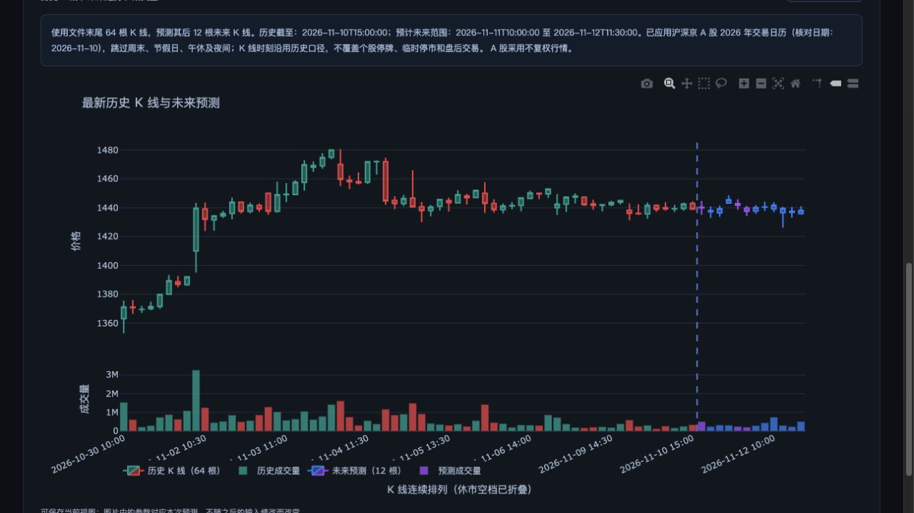

# Kronos Web

一个本地运行的中文 K 线预测网站，基于 [ShiYu/Kronos](https://github.com/shiyu-coder/Kronos) 开源模型。Python + Flask + Plotly，无需 Node.js 构建。

## 让 AI 自动启动项目（复制即用）

将下面整段提示词复制给**能够访问你电脑、执行终端命令的 AI 编程助手**。它会根据本机环境执行安装与启动；普通聊天窗口若没有终端权限，只能提供操作指导。首次安装需要联网，下载依赖和模型可能耗时较长；遇到系统权限请求时按需授权。

```text
请帮我在这台电脑上安装并启动 Kronos Web，直接执行操作，不要只给我教程。
项目仓库：https://github.com/EspressoToast/kronos-web
目标：在本地浏览器打开中文 K 线预测网站，并确认服务正常运行。

请按顺序完成：
1. 检查当前工作目录与操作系统，阅读项目的 README 和适用的 AGENTS.md。若已有此项目，优先复用并保留我的本地修改；若没有，在合适的用户目录克隆仓库，说明保存路径，不覆盖已有文件夹。
2. 检查 Git 和 Python。使用 Python 3.12，在项目内创建或复用兼容的 .venv，使用该虚拟环境的 Python 安装 requirements.txt。缺少工具时通过官方渠道或可信包管理器安装，不修改系统默认 Python。Windows 使用对应的 Scripts 路径；不需要安装 Node.js。
3. 检查计算设备：Apple 芯片优先检测 PyTorch MPS，NVIDIA 显卡检测 CUDA，其余使用 CPU。不假定加速可用；检测失败时回退 CPU。
4. 检查 7071 端口。如果已是本项目的正常服务，直接复用；若被其他程序占用，不终止那个程序，选择空闲端口并通过 PORT 环境变量启动。
5. 在项目目录使用虚拟环境的 Python 运行 run.py，仅监听 127.0.0.1。让服务在本次操作结束后继续运行，保存日志并记录进程信息；不要部署到公网。
6. 实际请求首页和 /api/available-models，确认页面正常、模型列表可用，再打开浏览器。若报错，检查日志、修复环境或启动问题后重试，不要只凭进程启动就宣布成功。
7. 默认使用 Kronos-small。说明页面中应选择的计算设备，以及“搜索标的名称或股票代码并选择周期 → 点击开始预测”的操作。首次点击会下载模型并获取行情；仅打开首页不代表模型预测已验证。不要为了启动页面强制下载行情或修改预测逻辑。
8. 最后简短告诉我：项目路径、实际访问地址、如何停止和再次启动，以及是否还有未解决的问题。如果受到网络或权限限制，明确说明具体阻碍和我需要做的最少操作，不要声称已完成。

除非缺少必要权限或关键信息，请自行处理常规安装与启动步骤。不要删除我的文件、覆盖本地修改、提交代码或购买云服务。
```

启动后可继续阅读下方的[新手引导](#新手引导)。也可以按[本地启动](#本地启动)手动安装。

## 功能

- 深色网站布局，顶部集中筛选、下方全宽图表；支持 CPU、Apple MPS、CUDA。
- 统一标的搜索：支持期货名称、沪深京 A 股名称、六位股票代码及交易所前缀（如 `sz000001`）。
- 一键完成模型加载、行情获取和预测；高级参数使用滑块调整。
- 使用文件末尾最新历史数据预测其后的未来 K 线。
- K 线等距连续排列，折叠休市空白，区分历史与预测。
- 刷新本地数据目录，无需重新加载模型。
- 导出带模型、参数、数据来源文件和时间范围的 PNG。
- 沪深京 A 股 2026 年节假日与交易时段日历；大商所、上期所休市及停夜盘日历。
- 在线获取期货与 A 股分钟线、日线，以及日线聚合的周线、月线；支持更新标的数据库。

## 本地启动

使用 **Python 3.12**（依赖基线适配版本）。

```bash
python3.12 -m venv .venv
source .venv/bin/activate
python -m pip install -r requirements.txt
python run.py
```

浏览器打开 **http://127.0.0.1:7071**。

Windows：使用 `py -3.12 -m venv .venv` 创建环境，然后运行 `.venv\Scripts\activate`，其余 Python 命令相同。macOS/Linux 完成依赖安装后也可运行 `./start.command`；macOS 可双击该文件。脚本日志写入 `logs/webui.log`。

默认仅监听本机。可用 `PORT=7080 python run.py` 修改端口。停止服务按 `Control+C`。

## 新手引导

启动项目后，在浏览器打开 http://127.0.0.1:7071/。下面是横屏网页版界面，可直接按名称或代码查找标的：


第一次使用，按这 5 步操作：

1. **选择模型**：保留默认的 `Kronos-small`。
2. **计算设备**：Apple 芯片 Mac 选择 `MPS`；其他情况先选 `CPU`。配有兼容 NVIDIA 显卡且已配置 CUDA 环境时，可选择 `CUDA`。
3. **选择行情**：在“标的名称”输入期货或股票名称（例如“棕榈”“贵州茅台”），也可输入六位股票代码（例如 `000001`、`600519`），点击搜索结果选中标的；K 线周期先用 **30 分钟**。
4. **开始预测**：高级选项先不改。点击“开始预测”后，系统会依次加载模型 → 获取并加载最新行情 → 生成预测。首次使用需要联网下载模型及 tokenizer，等待页面进度完成即可；失败时按页面提示处理。
5. **查看与保存结果**：向下滚动到“行情与预测”。虚线左侧是历史 K 线，右侧是预测，下方柱状图是成交量（数据包含成交量时）。点击“导出图片”保存 PNG，图片包含本次预测信息。

示例结果：贵州茅台（`600519`）30 分钟 K 线，使用 64 根历史数据预测未来 12 根。截图为操作示例，非默认参数，也不代表收益表现。



### 常用设置

- **更新标的数据库**：刷新期货与 A 股名称/代码目录；首次加载可能较慢。输入后需点击结果选中，也可用方向键和回车。修改搜索文字会清除旧标的选择。
- **高级选项**：默认使用 400 条历史数据、预测 120 条，温度 T = 1.0、top_p = 0.9、采样 1 次。需要时展开后拖动滑块修改，历史窗口最多 512 条。交易日历也在这里调整。
- **预测条数的含义**：30 分钟周期下，预测 120 条表示未来 120 根 30 分钟 K 线，不是 120 天；日线预测 20 条表示未来 20 根日 K 线。
- **自动更新行情**：勾选后，页面可见且未预测时每 60 秒刷新数据，**不会自动重新预测**。需要新预测时再次点击“开始预测”。
- **使用本地文件**：在“标的名称”中搜索并选择“本地数据文件”，选择文件后点击“开始预测”。新增文件放入 `data/`，再点击“刷新文件列表”，无需重新进入网站。

交易日历当前只覆盖 2026 年，不能把跨年范围当作已确认交易日期。临时停市与品种特殊调整不在此静态日历中。

## 在线行情与交易日历

### 期货与 A 股

- 标的目录从新浪财经获取，按日缓存；更新失败时尽量保留已有缓存并提示。某一市场不可用时，另一市场仍可使用。标的数量随数据源变化。
- 支持 **5 / 15 / 30 / 60 分钟、日线、周线、月线**。周/月线由日线聚合开高低收与成交量；最新一根及当前周/月可能尚未结束。
- A 股使用**不复权价格**，成交量单位为股。除权除息可能形成价格跳变；不应将其直接理解为模型识别到的涨跌信号。
- 在线数据少于设置的历史窗口时，会自动缩小历史输入条数。数据源返回的历史长度有限，部分标的或周期可能没有数据，页面会明确提示。
- “更新标的数据库”更新名称与代码目录；“开始预测”获取该标的最新行情并预测；“每 60 秒自动更新行情”仅刷新数据，不生成新预测。
- 数据和来源元信息写入 `data/`，被 Git 忽略。公开行情可能有延迟，页面显示最后一根 K 线时刻及抓取时间。

### A 股交易日历

沪深京 A 股自动应用 **2026 年交易日历**，旧版本下载的 A 股文件也会使用新日历：

- 分钟线跳过周末、节假日、午休及夜间，沿用历史 K 线的时间标记；常规竞价 K 线时段为 09:30–11:30、13:00–15:00。
- 日线只在交易日生成；调休周末仍然休市。例如 2026 年 9 月 30 日之后的日线依次为 10 月 8 日、9 日、12 日。
- 周线、月线从下一周期开始，取该周期**最后一个交易日**作为日期；整周休市则跳过。例如 2026 年 10 月月线日期为 10 月 30 日。
- 超出已核对的 2026 年范围会明确报错。预测条数过多时，可先减少条数；后续年份须核对公告并更新配置。
- 不覆盖个股停牌、临时停市和盘后固定价格交易。

公告来源：[上交所](https://www.sse.com.cn/disclosure/announcement/general/c/c_20251222_10802507.shtml)、[深交所](https://www.szse.cn/disclosure/notice/general/t20251222_618087.html)、[北交所](https://www.bse.cn/important_news/200027428.html)。日期、来源和核对版本保存在 [A 股日历配置](webui/calendars/cn_a_shares_2026.json)。

### 期货交易日历

大商所、上期所使用 2026 年休市及停夜盘日历。其余期货交易所暂按历史时段推算并提示。期货周/月预测仍使用下一周期结束日标签，不代表已核对的具体交易日；A 股周/月预测则使用周期最后一个交易日。

也可运行 `python scripts/download_market.py --list` 查看期货目录，运行 `python scripts/download_market.py --node zly_qh --period monthly` 下载棕榈油月线。命令行下载 A 股可用 `python scripts/download_market.py --node sh600519 --period 30`；网页提供统一名称/代码搜索。需要定时下载时可自行调度该脚本，网页轮询不依赖系统定时任务。

## 数据

```bash
python scripts/download_data.py --symbol A0 --period 30
python scripts/download_data.py --symbol SS0 --period 30
python scripts/download_data.py --symbol P0 --period daily
```

可选周期：`1`、`5`、`15`、`30`、`60`、`daily`。数据来自新浪公开接口；分钟历史长度由数据源决定，接口可能变化。下载脚本保留来源说明，过滤无效 OHLC 行，不自行复权。请遵守数据提供方的使用条款。第三方行情和模型权重均不随源码分发。

也可把 CSV 或 Feather 放在 `data/`。必需字段为 `timestamps`（或 `timestamp` / `date`）、`open`、`high`、`low`、`close`；可选 `volume`、`amount`。时间使用北京时间且保持一致；缺少时间字段会报错。仅允许加载 `data/` 内的文件。

## 运行与验证

```bash
python -m unittest discover -s tests -p 'test_*.py'
```

测试不下载模型，覆盖股票代码前导零、行情聚合、目录缓存回退、A 股节假日/午休/周月线日期、期货夜盘，以及超出日历覆盖范围等场景。真实模型预测需先下载权重。

- `run.py`：启动入口。
- `webui/app.py`：数据和预测 API。
- `webui/templates/index.html`：中文网站。
- `webui/trading_calendar.py`：交易时段过滤。
- `webui/market_data.py`：期货与 A 股标的目录、行情下载和缓存。
- `webui/calendars/cn_futures_2026.json`：期货日历日期、覆盖范围与公告来源。
- `webui/calendars/cn_a_shares_2026.json`：沪深京 A 股休市日期、交易时段和公告来源。
- `model/`：上游模型实现，预测器初始化切换到 eval 模式。

新年度日历应在核对交易所公告后扩展配置与测试，不能仅修改覆盖年份。已加载模型驻留内存；本网站按单用户本地工具设计，尚未实现账号、配额或多用户任务队列。前端 Plotly 与 Axios 使用 CDN，需联网加载。运行时缓存、日志、行情和预测结果均被 Git 忽略。

## 开源说明

本项目是基于 Kronos 的非官方衍生网站，保留上游版权声明和 MIT 许可证，详见 [LICENSE](LICENSE) 与 [NOTICE](NOTICE)。模型权重由 Hugging Face 单独提供，应遵循相应模型仓库的许可。模型输出具有随机性，示例不代表已验证的交易策略。

GitHub 仓库用于公开源码；GitHub Pages 不能直接运行 Python/PyTorch 后端。当前交付为可本地运行的网站，未部署公网推理服务。
