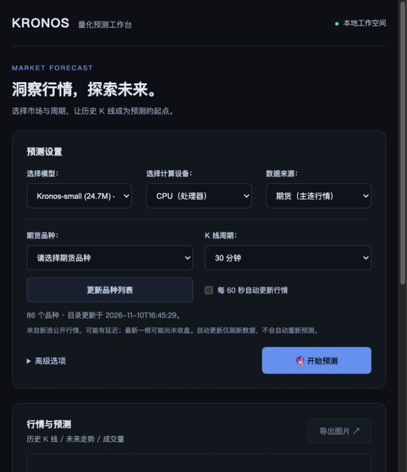

# Kronos Web

一个本地运行的中文 K 线预测网站，基于 [ShiYu/Kronos](https://github.com/shiyu-coder/Kronos) 开源模型。Python + Flask + Plotly，无需 Node.js 构建。

## 功能

- 深色网站布局，顶部集中筛选、下方全宽图表；支持 CPU、Apple MPS、CUDA。
- 一键完成模型加载、行情获取和预测；高级参数使用滑块调整。
- 使用文件末尾最新历史数据预测其后的未来 K 线。
- K 线等距连续排列，折叠休市空白，区分历史与预测。
- 刷新本地数据目录，无需重新加载模型。
- 导出带模型、参数、数据来源文件和时间范围的 PNG。
- 大商所、上期所 2026 年休市及停夜盘日历；跨出覆盖年份时明确报错。
- 配套下载豆一、棕榈油、不锈钢主连的分钟与日线数据。

## 本地启动

使用 **Python 3.12**（依赖基线适配版本）。

```bash
python3.12 -m venv .venv
source .venv/bin/activate
python -m pip install -r requirements.txt
python scripts/download_data.py --symbol P0 --period 30
python run.py
```

浏览器打开 **http://127.0.0.1:7071**。

Windows：使用 `py -3.12 -m venv .venv` 创建环境，然后运行 `.venv\Scripts\activate`，其余 Python 命令相同。macOS/Linux 完成依赖安装后也可运行 `./start.command`；macOS 可双击该文件。脚本日志写入 `logs/webui.log`。

默认仅监听本机。可用 `PORT=7080 python run.py` 修改端口。停止服务按 `Control+C`。

## 新手引导

启动项目后，在浏览器打开 http://127.0.0.1:7071/。下面是网站的预测设置界面：



第一次使用，按这 5 步操作：

1. **选择模型**：保留默认的 `Kronos-small`。
2. **计算设备**：Apple 芯片 Mac 选择 `MPS`；其他情况先选 `CPU`。配有兼容 NVIDIA 显卡且已配置 CUDA 环境时，可选择 `CUDA`。
3. **选择行情**：数据来源保留“期货（主连行情）”，选择品种，例如“棕榈主连”；K 线周期先用 **30 分钟**。
4. **开始预测**：高级选项先不改。点击“开始预测”后，系统会依次加载模型 → 获取并加载最新行情 → 生成预测。首次使用需要联网下载模型及 tokenizer，等待页面进度完成即可；失败时按页面提示处理。
5. **查看与保存结果**：向下滚动到“行情与预测”。虚线左侧是历史 K 线，右侧是预测，下方柱状图是成交量（数据包含成交量时）。点击“导出图片”保存 PNG，图片包含本次预测信息。

### 常用设置

- **高级选项**：默认使用 400 条历史数据、预测 120 条，温度 T = 1.0、top_p = 0.9、采样 1 次。需要时展开后拖动滑块修改，历史窗口最多 512 条。交易日历也在这里调整。
- **预测条数的含义**：30 分钟周期下，预测 120 条表示未来 120 根 30 分钟 K 线，不是 120 天；日线预测 20 条表示未来 20 根日 K 线。
- **自动更新行情**：勾选后，页面可见且未预测时每 60 秒刷新数据，**不会自动重新预测**。需要新预测时再次点击“开始预测”。
- **使用本地文件**：切换数据来源为“本地数据文件”，选择文件后点击“开始预测”。新增文件放入 `data/`，再点击“刷新文件列表”，无需重新进入网站。

交易日历当前只覆盖 2026 年，不能把跨年范围当作已确认交易日期。临时停市与品种特殊调整不在此静态日历中。

## 数据

```bash
python scripts/download_data.py --symbol A0 --period 30
python scripts/download_data.py --symbol SS0 --period 30
python scripts/download_data.py --symbol P0 --period daily
```

可选周期：`1`、`5`、`15`、`30`、`60`、`daily`。数据来自新浪公开接口；分钟历史长度由数据源决定，接口可能变化。下载脚本保留来源说明，过滤无效 OHLC 行，不自行复权。请遵守数据提供方的使用条款。第三方行情和模型权重均不随源码分发。

也可把 CSV 或 Feather 放在 `data/`。必需字段为 `timestamps`（或 `timestamp` / `date`）、`open`、`high`、`low`、`close`；可选 `volume`、`amount`。时间使用北京时间且保持一致；缺少时间字段会报错。仅允许加载 `data/` 内的文件。

## 运行与验证

```bash
python -m unittest discover -s tests -p 'test_*.py'
```

测试不下载模型，覆盖休市、周末、节前夜盘、节后恢复、跨午夜和超出日历覆盖范围。真实模型预测需先下载权重。

- `run.py`：启动入口。
- `webui/app.py`：数据和预测 API。
- `webui/templates/index.html`：中文网站。
- `webui/trading_calendar.py`：交易时段过滤。
- `webui/calendars/cn_futures_2026.json`：日历日期、覆盖范围与公告来源。
- `model/`：上游模型实现，预测器初始化切换到 eval 模式。

新年度日历应在核对交易所公告后扩展配置与测试，不能仅修改覆盖年份。已加载模型驻留内存；本网站按单用户本地工具设计，尚未实现账号、配额或多用户任务队列。前端 Plotly 与 Axios 使用 CDN，需联网加载。运行时缓存、日志、行情和预测结果均被 Git 忽略。

## 开源说明

本项目是基于 Kronos 的非官方衍生网站，保留上游版权声明和 MIT 许可证，详见 [LICENSE](LICENSE) 与 [NOTICE](NOTICE)。模型权重由 Hugging Face 单独提供，应遵循相应模型仓库的许可。模型输出具有随机性，示例不代表已验证的交易策略。

GitHub 仓库用于公开源码；GitHub Pages 不能直接运行 Python/PyTorch 后端。当前交付为可本地运行的网站，未部署公网推理服务。

## 在线期货行情

在数据来源中选择「期货（主连行情）」→ 品种 → K 线周期。品种列表从新浪财经自动抓取，按交易所分组，每天缓存，可手动更新。点击「开始预测」后自动获取最新行情并加载。提供 5/15/30/60 分钟、日线、周线和月线；周/月线使用日线的开盘首值、最高最大值、最低最小值、收盘末值与成交量之和聚合。

勾选「每 60 秒自动更新行情」后，在页面可见且未预测时轮询，关闭页面即停止。仅更新数据，不自动重新预测或覆盖已展示的预测图。行情可能延迟，当根可能未收盘；页面显示来源时间及抓取时间，下载失败保留磁盘文件但禁止用失败状态直接预测。目录失败时使用已有缓存并显示提示。部分品种/周期可能不被数据源支持，会明确报错。

在线数据不足默认历史窗口时自动缩小输入窗口。周/月预测从下一周期开始，日期使用周期结束日标签，不冒充交易日；当前未完成周期仍作为模型输入。大商所和上期所使用现有日历，其他交易所暂按历史时段推算并提示。数据和元信息只保存在被 Git 忽略的 data/ 下。

也可运行 `python scripts/download_market.py --list` 查看自动发现的品种，再运行 `python scripts/download_market.py --node zly_qh --period monthly` 下载棕榈油月线。需要自己定时运行时，可调用该脚本；网页轮询不依赖系统定时任务。
